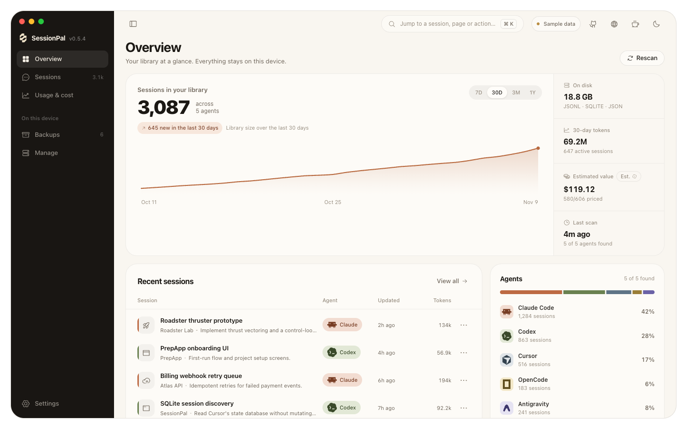
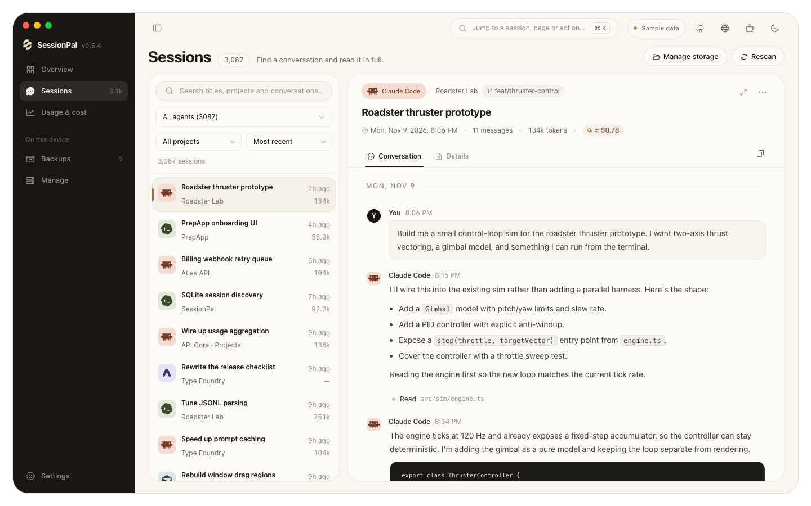
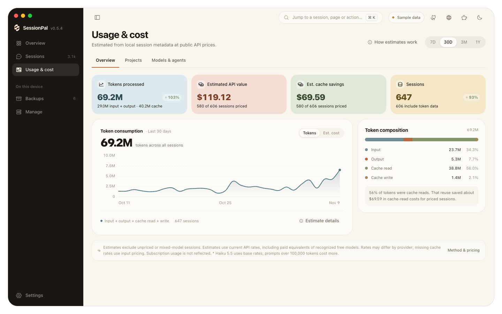
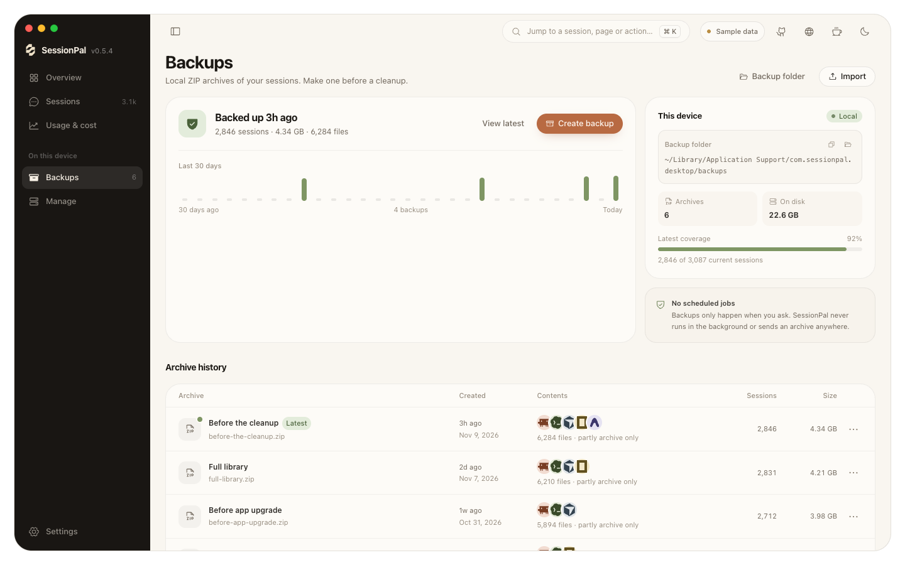
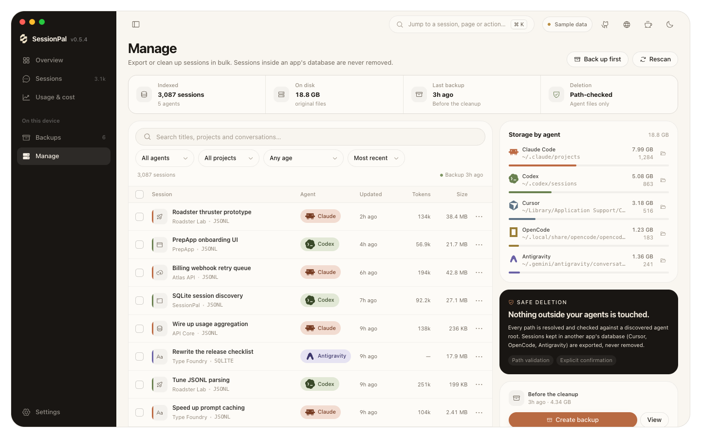
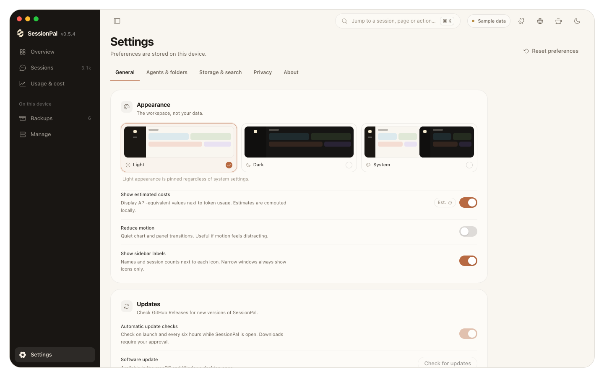

# SessionPal

**Your AI coding sessions, all in one place.**

SessionPal is a local-first desktop library for sessions from **Claude Code, Codex, Cursor, OpenCode, and Google Antigravity**. Find past conversations, explore usage, and back up sessions on your own computer.

[**Download for macOS or Windows**](https://github.com/essjaykay755/sessionpal/releases) · [Website](https://sessionpal.essjaykay.dev) · [Development guide](docs/development.md) · [Changelog](CHANGELOG.md)



## Get started

1. **Download and install** from [GitHub Releases](https://github.com/essjaykay755/sessionpal/releases). Choose the Apple Silicon or Intel `.dmg` for macOS 11 or newer, or the x64 setup `.exe` for Windows. Installers are unsigned, so Gatekeeper or SmartScreen may show a warning.
2. **Choose your agents.** On first launch, SessionPal checks which agents are available and asks which ones to include. On macOS, it can also request access to protected project folders for better project names and worktree grouping.
3. **Explore your library.** Search sessions, read transcripts, check usage, or create a backup before cleaning up.

See the [first-launch guide](docs/data-and-privacy.md#first-launch) for folder permissions and setup details. Want to try the interface without accessing local sessions? Run the [browser preview](docs/development.md#browser-preview).

## Find past conversations

Search titles, projects, models, and conversation text across your agents. Filter by agent or project, then read messages, code, tool calls, and results in the transcript reader. Export individual sessions or a selection as Markdown or JSON.



## Understand your usage

Explore tokens by time, project, model, and agent. See cache savings and estimated API-equivalent costs based on public model rates. These are **estimates, not bills**; subscription pricing and credits aren’t included.



[How cost estimates work](docs/data-and-privacy.md#cost-estimates)

## Back up before cleanup

Create portable ZIP archives with a manifest and session index, or import an existing archive. Restores validate and stage archive contents, then write only missing files; existing files are never overwritten. Database-backed sessions are archived for inspection and export but aren’t restored into live agent databases.



## Manage storage

See storage by agent and select supported file-based sessions for cleanup. Deletion requires confirmation, validates paths, and moves files to the Trash or Recycle Bin. Database-backed sessions remain read-only.



## Supported agents

| Agent | Browse & export | Backup | Restore | Delete |
| --- | --- | --- | --- | --- |
| Claude Code | Yes | Yes | Yes | Yes |
| Codex | Yes | Yes | Yes | Yes |
| Cursor | Yes | Archive only | No | No |
| OpenCode | Yes | Yes (database: archive only) | File-based sessions | File-based sessions |
| Google Antigravity | Yes | Archive only | No | No |

Archive-only backups retain conversations for inspection and export; SessionPal never writes them back to the agents’ live databases. Availability and detail depend on what each agent records. See [storage formats and paths](docs/data-and-privacy.md#supported-agents) and [limitations](docs/data-and-privacy.md#limitations).

## Private by design

- **Your conversations stay on your device.** There is no account, cloud sync, telemetry, analytics, or crash reporting.
- **Search is local.** A local SQLite index stores conversation text for full-text search; it excludes tool output and can be rebuilt.
- **You control backups and cleanup.** Backups run only when requested, and destructive actions require confirmation.
- **Network requests are limited.** SessionPal fetches public model pricing and checks GitHub Releases for updates. Pricing requests include no session data; automatic update checks can be disabled in Settings.

Read the full [privacy and safety guide](docs/data-and-privacy.md#privacy-and-safety), including read-only databases, restore protections, and [data locations](docs/data-and-privacy.md#data-locations).

## Customize your workspace

Choose light, dark, or system appearance, reduce motion if you prefer, and use the command palette (`⌘K` / `Ctrl+K`) to navigate quickly.

<details>
<summary>See Settings</summary>



</details>

## Build and contribute

SessionPal uses React and Tauri 2. To run the browser preview:

```bash
npm install
npm run dev
```

Open <http://localhost:1420> to explore the sample library. For prerequisites, desktop builds, tests, repository layout, and release signing, see the [development guide](docs/development.md).

Issues and pull requests are welcome. Please preserve the local-first privacy model and run the TypeScript build and `cargo test` before opening a pull request.

## Support

Made by [Subhojit Karmakar](https://essjaykay.dev). If you enjoy SessionPal, you can support its development:

<a href="https://buymeacoffee.com/essjaykay"></a>

## License

MIT. See [LICENSE](LICENSE). SessionPal is not affiliated with Anthropic, OpenAI, Cursor, OpenCode, or Google.
